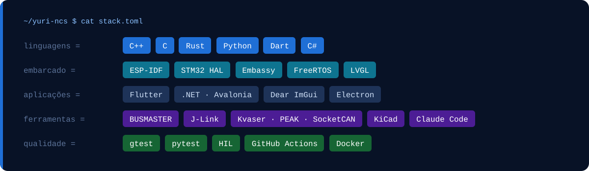
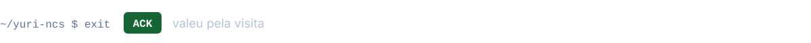

<picture>
  <source media="(prefers-color-scheme: light)" srcset="./assets/banner-light.svg">
  
</picture>

<p>
  <a href="https://github.com/yuri-ncs"></a>
  <a href="mailto:yurineves2204@gmail.com"></a>
  <a href="https://github.com/Marine-Telematics"></a>
</p>

<picture>
  <source media="(prefers-color-scheme: light)" srcset="./assets/h-sobre-light.svg">
  
</picture>

<details open>
<summary><b>yuri.h</b></summary>

```cpp
#ifndef YURI_H
#define YURI_H

#include "marine_telematics.h"

// Firmware & software · Marine Telematics · desde 2024
class Yuri {
public:
    struct Cargo {
        const char* titulo;
        const char* foco;
    };

    static constexpr Cargo cargo = {
        .titulo = "Firmware & Software Developer",
        .foco   = "propulsão, telemetria e automação marítima",
    };

    static constexpr Mcu mcus[] = {
        Mcu::ESP32,
        Mcu::STM32,
        Mcu::MSPM0,
    };

    static constexpr Bus barramentos[] = {
        Bus::CAN,      // j1939 | nmea2000 | iso11783
        Bus::RS485,    // j1708 | j1587
        Bus::SERIAL,   // uart | rs232
        Bus::I2C,
        Bus::SPI,
        Bus::USB,      // vendor class | winusb | libusb
    };

    static constexpr Radio radio[] = {
        Radio::BLE,    // gatt | ota
        Radio::WIFI,   // softap | esp-now
        Radio::LTE_4G,
        Radio::LORA,
    };

    static constexpr Tool kit[] = {
        Tool::BUSMASTER,
        Tool::J_LINK,
        Tool::CLAUDE_CODE,
    };

    static constexpr const char* por_fora[] = {
        "Rust embarcado",
        "Go",
    };

    [[noreturn]] void work();
};

#endif // YURI_H
```

</details>

<picture>
  <source media="(prefers-color-scheme: light)" srcset="./assets/h-stack-light.svg">
  
</picture>

<picture>
  <source media="(prefers-color-scheme: light)" srcset="./assets/stack-light.svg">
  
</picture>

<picture>
  <source media="(prefers-color-scheme: light)" srcset="./assets/h-atividade-light.svg">
  
</picture>

<p align="center">
  <picture>
    <source media="(prefers-color-scheme: light)" srcset="https://streak-stats.demolab.com/?user=yuri-ncs&locale=pt_BR&hide_border=true&border_radius=16&card_width=1000&card_height=200&disable_animations=true&background=F6F8FC&stroke=DCE5F2&ring=1F6FD6&fire=1F6FD6&currStreakNum=0B1A33&sideNums=0B1A33&currStreakLabel=1F6FD6&sideLabels=475A78&dates=64748B">
    
  </picture>
</p>

<picture>
  <source media="(prefers-color-scheme: light)" srcset="./assets/footer-light.svg">
  
</picture>
