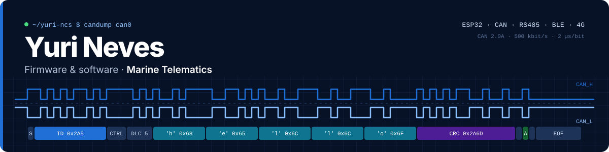

<picture>
  <source media="(prefers-color-scheme: light)" srcset="./assets/banner-light.svg">
  
</picture>

<p>
  <a href="https://github.com/yuri-ncs"></a>
  <a href="mailto:yurineves2204@gmail.com"></a>
  <a href="https://github.com/Marine-Telematics"></a>
</p>

## `0x01` Sobre mim

<details open>
<summary><b>yuri.h</b></summary>

```cpp
#ifndef YURI_H
#define YURI_H

#include "marine_telematics.h"

// Firmware & software · Marine Telematics · desde 2024
class Yuri {
public:
    struct Cargo {
        const char* titulo;
        const char* foco;
    };

    static constexpr Cargo cargo = {
        .titulo = "Firmware & Software Developer",
        .foco   = "ECUs de propulsão e telemetria marítima",
    };

    static constexpr Mcu mcus[] = {
        Mcu::ESP32,
        Mcu::STM32,
        Mcu::MSPM0,
    };

    static constexpr Bus barramentos[] = {
        Bus::CAN,      // j1939 | nmea2000 | iso11783
        Bus::RS485,    // j1708 | j1587
        Bus::SERIAL,   // uart | rs232
        Bus::I2C,
        Bus::SPI,
        Bus::USB,      // vendor class | winusb | libusb
    };

    static constexpr Radio radio[] = {
        Radio::BLE,    // gatt | ota
        Radio::WIFI,   // softap | esp-now
        Radio::LTE_4G,
        Radio::LORA,
    };

    static constexpr Tool kit[] = {
        Tool::BUSMASTER,
        Tool::J_LINK,
        Tool::CLAUDE_CODE,
    };

    static constexpr const char* por_fora[] = {
        "Rust embarcado",
        "Go",
    };

    [[noreturn]] void work();
};

#endif // YURI_H
```

</details>

## `0x02` Stack

<table>
  <tr>
    <td><code>linguagens</code></td>
    <td>
      
      
      
      
      
      
    </td>
  </tr>
  <tr>
    <td><code>embarcado</code></td>
    <td>
      
      
      
      
      
    </td>
  </tr>
  <tr>
    <td><code>aplicações</code></td>
    <td>
      
      
      
      
    </td>
  </tr>
  <tr>
    <td><code>ferramentas</code></td>
    <td>
      
      
      
      
      
    </td>
  </tr>
  <tr>
    <td><code>qualidade</code></td>
    <td>
      
      
      
      
      
    </td>
  </tr>
</table>

## `0x03` Atividade

<p>
  
  
</p>

---

<sub><code>~/yuri-ncs $ exit</code> &nbsp;·&nbsp; <b>ACK</b> · Valeu pela visita</sub>
